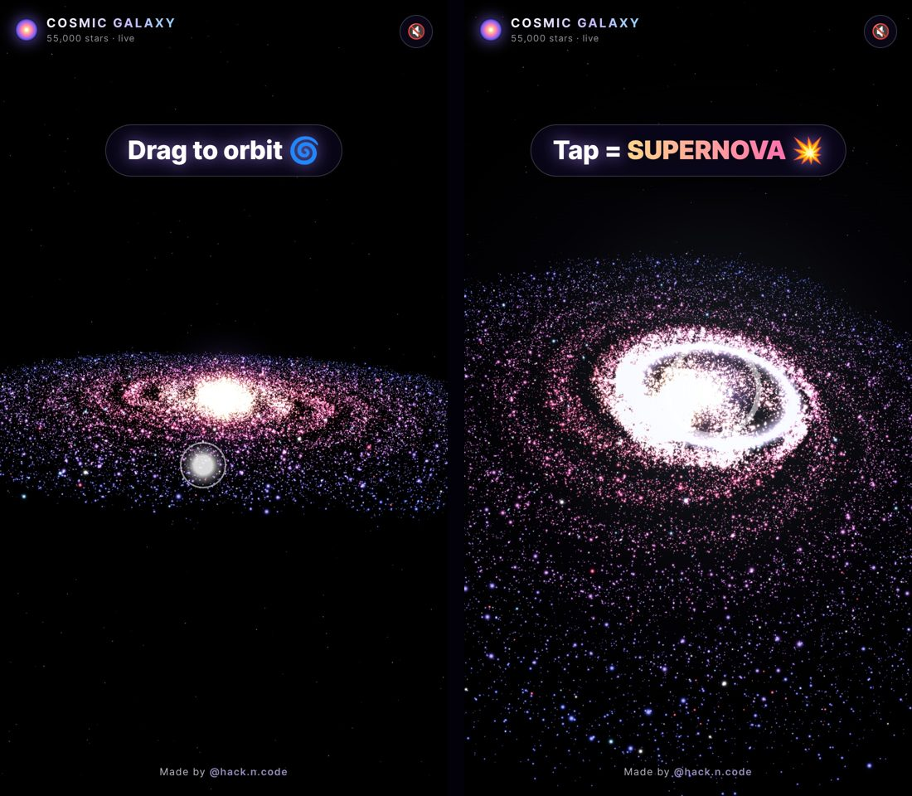

# 🌌 Cosmic Galaxy — 3D Interactive Galaxy

**55,000 glowing stars** in a 4-arm spiral galaxy, written in JavaScript with Three.js and hand-written GLSL shaders.
Drag to orbit, pinch or scroll to zoom, and **tap anywhere for a SUPERNOVA 💥**

### 🔴 Live demo → **https://galaxy-hackncode.sites.tab.bot/**



## ✨ Features
- 55,000 stars on desktop (26,000 on phones for smooth 60 fps)
- Real **differential rotation**: inner stars orbit faster than outer ones, all done on the GPU
- Bloom-like glow from custom point-sprite shaders with additive blending (no post-processing needed)
- Hand-rolled orbit controls with inertia: drag, wheel zoom, two-finger pinch
- **Supernova**: flash + particle debris + double shockwave rings, and nearby stars get pushed outward by the blast wave
- Synthesized boom sound with the Web Audio API (muted by default, tap 🔇 to turn it on)
- Seeded random, so you get the same galaxy on every load
- Mobile-first, safe-area aware, zero build step

## 🚀 Run it
No install needed. Clone the repo and open `index.html` with any local server (VS Code **Live Server** works):

```bash
git clone https://github.com/hackncode1020/galaxy-25-10-26
cd galaxy-25-10-26
npx serve .        # or: python -m http.server
```

## 🐍 Python version
`python/galaxy.py` is a rotating spiral galaxy in pygame + numpy. Click for a supernova shockwave.

```bash
pip install pygame numpy
python python/galaxy.py
```

## 🧠 How it works
Each star gets a radius `r`, an arm `branch` and a spin angle `r * spin`. Its position is `cos/sin(branch + spin) * r` plus some Gaussian scatter.
The vertex shader rotates every star by `time * 0.11 / sqrt(r)` and adds an outward push wherever the supernova shockwave ring passes.

## 📁 Files
| File | What |
|---|---|
| `index.html` | page + UI |
| `style.css` | glassy minimal UI |
| `galaxy.js` | galaxy generation, shaders, controls, supernova |
| `python/galaxy.py` | Python version |

---
Made with 💜 by **[@hack.n.code](https://instagram.com/hack.n.code)** · Follow for more coding animations
MIT License
